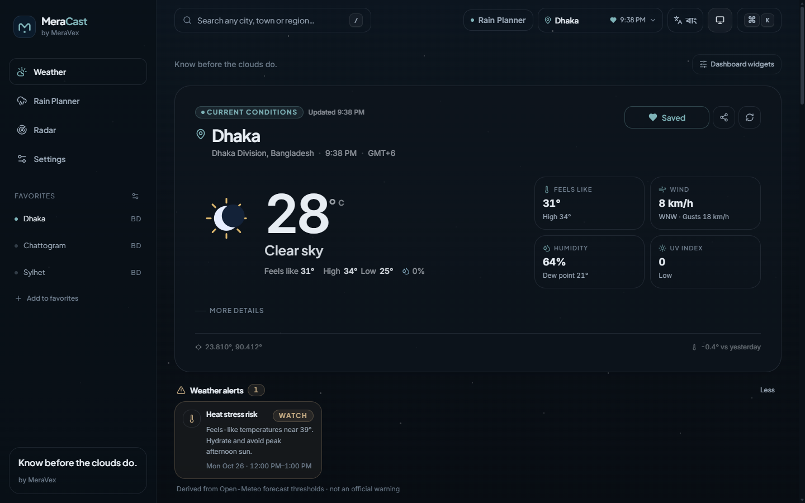
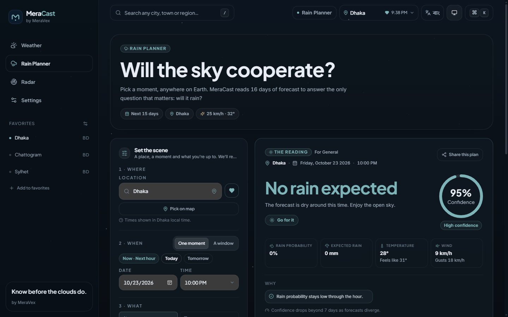
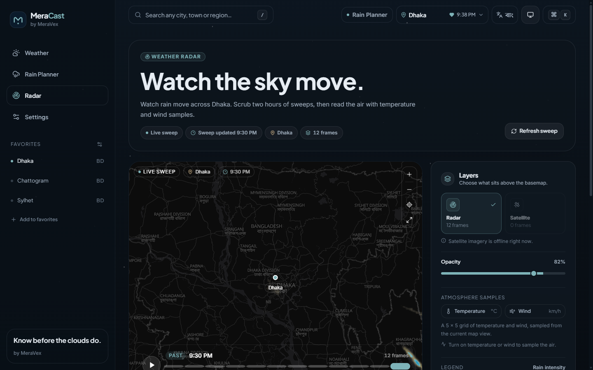
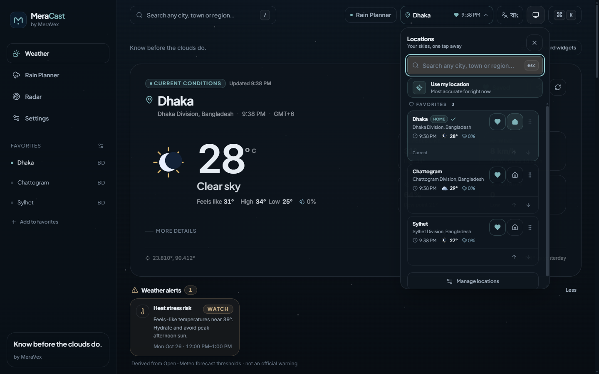
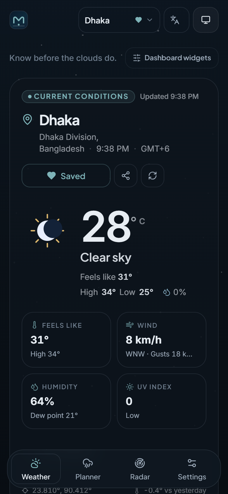

# MeraCast

**মেঘের আগেই জেনে নিন।**

[English](README.md) · [**বাংলা**](README.bn.md)

MeraCast হলো MeraVex-এর তৈরি একটি দ্বিভাষিক (ইংরেজি / বাংলা) আবহাওয়া স্টুডিও। এতে এক জায়গায় আছে বর্তমান আবহাওয়া, ৪৮ ঘণ্টার পূর্বাভাস, ১৬ দিনের পূর্বাভাস, বায়ুর গুণমান, জ্যোতির্বিজ্ঞান, অ্যানিমেটেড রাডার এবং বিশেষভাবে তৈরি Rain Planner — সবই শান্ত, সিনেম্যাটিক ইন্টারফেসে।

Next.js 14 App Router, strict TypeScript, Tailwind CSS, Framer Motion, Recharts, MapLibre GL, Zustand এবং TanStack Query দিয়ে এটি তৈরি। কোনো API key, অ্যাকাউন্ট বা ট্র্যাকার লাগে না।

> **লাইভ ডেমো:** _ডিপ্লয়ের পরে URL এখানে যোগ করুন।_ ডিপ্লয়ের ধাপ নিচে দেওয়া আছে।

## স্ক্রিনশট

| আবহাওয়া ড্যাশবোর্ড | Rain Planner |
| --- | --- |
|  |  |
| **লাইভ রাডার** | **দ্রুত স্থান পরিবর্তন** |
|  |  |

<p align="center">
  
</p>

স্ক্রিনশটগুলো এই রিপজিটরির প্রোডাকশন বিল্ড থেকে নেওয়া; এতে নমুনা হিসেবে কয়েকটি সংরক্ষিত স্থান দেখানো হয়েছে।

---

## বৈশিষ্ট্য

### পূর্বাভাস ও আবহাওয়া
- কাস্টম অ্যানিমেটেড আইকন ও দৃশ্যসহ বর্তমান আবহাওয়া।
- ৪৮ ঘণ্টার ঘণ্টাভিত্তিক পূর্বাভাস, সঙ্গে lazy-loaded তাপমাত্রা ও বৃষ্টির চার্ট।
- ১৬ দিনের দৈনিক পূর্বাভাস, তাপমাত্রার রেঞ্জ বার ও বিস্তারিত তথ্যসহ।
- বায়ুর গুণমান (European AQI), দূষণকারীর বিশ্লেষণ ও স্বাস্থ্য-পরামর্শ।
- সূর্যোদয়, সূর্যাস্ত, গোল্ডেন আওয়ার, ব্লু আওয়ার, দিনের দৈর্ঘ্য, চাঁদের দশা ও আলোকিত অংশ।
- অতীতের একই তারিখের আবহাওয়ার সঙ্গে তুলনা।
- স্থান অনুযায়ী আবহাওয়া দৃশ্য: পরিষ্কার, বৃষ্টি, ঝড়, তুষার, কুয়াশা, বাতাস ও রাত।
- পোশাক, ব্যায়াম, ফটোগ্রাফি, ভ্রমণসহ দৈনন্দিন পরামর্শ।
- MeraCast-এর নিজস্ব সতর্কতা: ভারী বৃষ্টি, ঝড়, অতিরিক্ত গরম, বাতাস ও কম দৃশ্যমানতা।

### খোঁজ ও স্থান
- Open-Meteo জিওকোডিং দিয়ে ডিবাউন্সড স্থান-অনুসন্ধান ও অটোকমপ্লিট।
- হেডারের দ্রুত স্থান পরিবর্তন: সংরক্ষিত স্থান, প্রিয় তালিকা, সাম্প্রতিক খোঁজ ও একটি নির্দিষ্ট হোম লোকেশন — ডেস্কটপে popover, মোবাইলে bottom sheet।
- প্রিয় স্থান ও সাম্প্রতিক খোঁজ ব্রাউজারে সংরক্ষিত থাকে। প্রিয় স্থান ড্র্যাগ বা মুভ কন্ট্রোল দিয়ে সাজানো যায়; হোম সবসময় সবার আগে থাকে।
- ব্রাউজার জিওলোকেশন, অনুমতি ও টাইমআউটের পরিষ্কার হ্যান্ডলিংসহ।
- রিভার্স জিওকোডিংসহ ম্যাপ-ভিত্তিক লোকেশন পিকার।
- যেকোনো স্থানের শেয়ারযোগ্য URL; কিছু না দিলে ডিফল্ট ঢাকা।

### Rain Planner
- স্থান, তারিখ, সময় ও কার্যকলাপ বেছে নিন।
- সহজ ভাষায় উত্তর: **হ্যাঁ / সম্ভবত / অসম্ভব / না**, সঙ্গে “যান / পরিকল্পনা বি রাখুন / অন্য সময় বেছে নিন” পরামর্শ।
- ক্রিকেট, পিকনিক, বিয়ে, যাতায়াত, ভ্রমণ, হাইকিং, ফটোগ্রাফি, আউটডোর শুট, মাছ ধরা ও ঘুড়ি ওড়ানোর আলাদা থ্রেশহোল্ড।
- নির্বাচিত সময়ের আশপাশে তিন ঘণ্টার শুকনো জানালা খোঁজা।
- তারিখ-রেঞ্জ বিশ্লেষণে ভেজা ও শুকনো ঘণ্টার সংখ্যা।
- পূর্বাভাস যত দূরের, তত কমা confidence score এবং স্পষ্ট সতর্কতা।
- একাধিক সম্ভাব্য সময় পাশাপাশি তুলনা।
- ডাউনলোডযোগ্য শেয়ার কার্ড ও কপি করার মতো planner লিংক।

### রাডার
- RainViewer-এর লাইভ রাডার ফ্রেম, play/pause, scrubber ও কীবোর্ড-বান্ধব টাইমলাইন।
- OpenFreeMap-এর ডার্ক ও লাইট ভেক্টর বেসম্যাপ; রাডারের ওপরে স্থানের লেবেল।
- দুটি MapLibre raster লেয়ার দিয়ে মসৃণ ফ্রেম ক্রসফেড।
- রাডারের opacity, তাপমাত্রা ও বাতাসের ওভারলে এবং ম্যাপে ট্যাপ করে আবহাওয়া দেখা।
- ফুলস্ক্রিন, লিজেন্ড, সর্বশেষ ফ্রেমের তথ্য ও রাডার সংকেতের বিবরণ।
- RainViewer nowcast বা satellite ফ্রেম না দিলে সৎ খালি অবস্থা, বানানো তথ্য নয়।

### ব্যক্তিগতকরণ
- ইংরেজি ও বাংলা ইন্টারফেস; চাইলে বাংলা অঙ্ক।
- সেলসিয়াস / ফারেনহাইট, km/h / mph / m/s / kn, mm / in এবং hPa / inHg।
- ১২ ঘণ্টা ও ২৪ ঘণ্টার ঘড়ি।
- লাইট, ডার্ক ও সিস্টেম থিম; প্রথম রেন্ডারে থিমের ঝলক নেই।
- Reduced-motion ও performance মোড।
- উইজেট লেআউট কাস্টমাইজেশন: ড্র্যাগ, কীবোর্ড মুভ কন্ট্রোল ও আলাদা উইজেট দেখানো/লুকানো।
- বৃষ্টি আসছে, গুরুতর সতর্কতা ও সকালের সারাংশের জন্য নোটিফিকেশন নিয়ম।
- Quiet hours, cooldown ও টেস্ট নোটিফিকেশন।
- সমর্থিত ডিভাইসে হ্যাপটিক ফিডব্যাক।

### PWA, শেয়ারিং ও অ্যাক্সেসিবিলিটি
- ইনস্টলযোগ্য PWA: manifest shortcut, maskable icon ও inline অফলাইন ফলব্যাক।
- বিল্ড-স্ট্যাম্পড service worker: navigation শুধু network থেকে, যাচাই করা static asset cache, activate-এ পুরনো cache পরিষ্কার এবং স্পষ্ট update prompt।
- Service worker কোনো HTML ডকুমেন্ট cache করে না, তাই ডিপ্লয়ের পরে পুরনো shell ফিরে এসে মুছে যাওয়া CSS/JS দেখানোর সুযোগ নেই।
- অফলাইন ব্যানার ও লোকালি cache করা আবহাওয়া; navigation ব্যর্থ হলে অ্যাপের কোনো asset ছাড়াই স্বয়ংসম্পূর্ণ অফলাইন পেজ দেখানো হয়।
- ব্রাউজারে PNG শেয়ার কার্ড তৈরি।
- ট্যাব খোলা থাকলেই কেবল ঐচ্ছিক ব্রাউজার নোটিফিকেশন।
- Skip link, semantic landmark, দৃশ্যমান focus ring, dialog-এ focus trap, কীবোর্ড শর্টকাট (`/` স্থান পরিবর্তন, `Ctrl/Cmd+K` command palette, `Esc` বন্ধ) ও reduced-motion সাপোর্ট।
- SEO metadata, Open Graph/Twitter card, JSON-LD, `robots.txt` ও dynamic sitemap।

---

## প্রযুক্তি

| ক্ষেত্র | ব্যবহার |
| --- | --- |
| Framework | Next.js 14.2 (App Router, React Server Components) |
| ভাষা | TypeScript 5.7, `strict`, `noUncheckedIndexedAccess` |
| স্টাইল | Tailwind CSS 3.4, CSS custom property |
| ফন্ট | `next/font/local` দিয়ে self-hosted @fontsource WOFF2 |
| মোশন | Framer Motion 11, CSS transition |
| চার্ট | Recharts 2 |
| ম্যাপ | MapLibre GL 4, OpenFreeMap, RainViewer |
| স্টেট | Zustand 5, settings/locations persist |
| ডেটা | TanStack Query 5 + localStorage persistence |
| যাচাই | Zod |
| তারিখ/জ্যোতির্বিজ্ঞান | Native `Intl`, `suncalc` |
| শেয়ার ছবি | `html-to-image` |
| টেস্ট | Vitest + Testing Library + jsdom |

---

## শুরু করা

### যা লাগবে
- Node.js 20 বা নতুন (ডেভেলপমেন্টে Node 26 ব্যবহৃত)
- npm 10 বা নতুন

### ইনস্টল ও চালানো

```bash
npm install
npm run dev
```

তারপর <http://localhost:3000> খুলুন।

কোনো environment variable ছাড়াই অ্যাপটি চলে। ডিফল্ট বদলাতে চাইলে `.env.example` থেকে `.env.local` বানান:

```bash
cp .env.example .env.local
```

| Variable | আবশ্যক | কাজ |
| --- | --- | --- |
| `NEXT_PUBLIC_SITE_URL` | না | metadata, sitemap ও share link-এ ব্যবহৃত public origin। শেষে slash দেবেন না। |
| `MERACAST_DEBUG` | না | development-এ বিস্তারিত provider log দেখতে `1` দিন। |

### প্রোডাকশন বিল্ড

```bash
npm run build
npm start
```

Service worker ও install prompt শুধু প্রোডাকশন বিল্ডে সক্রিয়। PWA আচরণ পরীক্ষা করতে `localhost` বা HTTPS-এ `npm run build && npm start` চালান।

### PWA ও অফলাইন

- `npm run build` প্রথমে `npm run build:sw` চালায়। তৈরি worker-এ বিল্ড version বসে এবং সেটি `public/version.json`-এ লেখা হয়।
- Navigation সবসময় network থেকে আসে। Service worker cache-এ কোনো HTML ডকুমেন্ট 저장 হয় না। Navigation ব্যর্থ হলে worker inline style-যুক্ত একটি ছোট, স্বয়ংসম্পূর্ণ অফলাইন পেজ ফেরত দেয়।
- সঠিক MIME type-সহ সফল response পাওয়ার পর hashed Next.js asset, ফন্ট, icon ও manifest cache-first পদ্ধতিতে জমা হয়। নতুন worker activate হলে পুরনো MeraCast cache মুছে যায়।
- API response service worker cache করে না। অফলাইনে পড়ার জন্য TanStack Query আলাদা, সীমিত লোকাল cache রাখে।
- অ্যাপ খোলা থাকলে নতুন বিল্ড পাওয়া যায়। ইন্টারফেসে update prompt দেখা যায়; সেটি চাপলে worker বদলায়, পুরনো cache পরিষ্কার হয় এবং পেজ একবার reload হয়।
- Development-এ registration component আগের worker unregister করে ও MeraCast cache পরিষ্কার করে, যাতে প্রোডাকশন worker লোকাল পরিবর্তন ঢেকে না দেয়।

### স্ক্রিপ্ট

| কমান্ড | কাজ |
| --- | --- |
| `npm run dev` | Next.js development server চালু। |
| `npm run build` | প্রোডাকশন বিল্ড তৈরি। |
| `npm start` | প্রোডাকশন বিল্ড চালু। |
| `npm run lint` | ESLint (`next/core-web-vitals`) চালায়। |
| `npm run typecheck` | strict mode-এ `tsc --noEmit` চালায়। |
| `npm test` | Vitest suite একবার চালায়। |
| `npm run test:watch` | Vitest watch mode-এ চালায়। |
| `npm run format` | Prettier ও Tailwind class sorting। |
| `npm run format:check` | ফরম্যাটিং না বদলে যাচাই। |
| `npm run fonts` | `@fontsource` থেকে self-hosted WOFF2 `app/fonts`-এ কপি করে (dev/build-এর আগেও চলে)। |
| `npm run build:sw` | বর্তমান বিল্ডের জন্য `public/sw.js` ও `public/version.json` তৈরি করে (build-এর আগেও চলে)। |
| `npm run icons` | Sharp দিয়ে app icon ও Open Graph ছবি নতুন করে তৈরি করে। |

---

## প্রকল্পের কাঠামো

```text
app/
  api/                 cache করা route handler (weather, air, geocode, radar, history, grid, reverse)
  city/[slug]/         শেয়ারযোগ্য শহরের পূর্বাভাস পেজ
  radar/               রাডার অভিজ্ঞতা
  rain-planner/        Rain Planner অভিজ্ঞতা
  settings/            পছন্দ, নোটিফিকেশন, install ও privacy
  offline/             অফলাইন অভিজ্ঞতার route (service worker-এ inline fallback-ও আছে)
  fonts/               @fontsource থেকে তৈরি WOFF2 subset
  layout.tsx           ফন্ট, metadata, provider ও app chrome
  globals.css          design token, base style ও motion utility
components/
  brand/               MeraCast মার্ক ও wordmark
  charts/              lazy-loaded Recharts চার্ট
  command/             command palette
  dashboard/           পূর্বাভাস, বায়ু, সূর্য, ইতিহাস, জ্যোতির্বিজ্ঞান ও lifestyle কার্ড
  effects/             অ্যানিমেটেড আবহাওয়া দৃশ্য
  layout/              sidebar, header, দ্রুত স্থান পরিবর্তন, footer, bottom nav ও offline banner
  maps/                MapLibre location picker
  planner/             Rain Planner UI, তুলনা ও share card
  providers/           Query, i18n, theme ও store hydration provider
  pwa/                 install prompt, service-worker registration, offline UI
  radar/               রাডার ম্যাপ ও timeline UI
  search/              স্থান-অনুসন্ধান dialog
  settings/            settings ও widget customiser
  share/               আবহাওয়া share modal
  ui/                  button, card, modal, control, tooltip ও state
  weather/             আবহাওয়ার বিস্তারিত প্যানেল ও অ্যানিমেটেড আইকন
docs/screenshots/      README-তে ব্যবহৃত প্রোডাকশন স্ক্রিনশট
hooks/                 query, formatting, theme, haptics, geolocation, notification
i18n/                  typed ইংরেজি ও বাংলা অভিধান
lib/
  api/                 provider contract, Open-Meteo adapter, Zod schema, server fetch
  alerts.ts            থ্রেশহোল্ড থেকে তৈরি সতর্কতা
  format.ts            locale, সংখ্যা, তারিখ ও একক
  rain-planner.ts      planner স্কোরিং, window, confidence ও URL state
  nowcast.ts           মিনিট-স্তরের nowcast state machine
  indices.ts           lifestyle সূচক
  summary.ts           পড়ার উপযোগী পূর্বাভাস সারাংশ
  sun.ts               জ্যোতির্বিজ্ঞান ও চাঁদের দশা
scripts/               font sync, service-worker generation, icon ও font-manifest repair
store/                 settings, locations, UI ও scene-এর Zustand store
tests/                 unit test ও আবহাওয়া fixture
types/                 শেয়ার্ড domain type
public/                manifest, তৈরি worker, version marker, icon ও OG ছবি
```

---

## ডেটা সোর্স

MeraCast শুধু key ছাড়া ব্যবহারযোগ্য উন্মুক্ত সেবা ব্যবহার করে:

- **Open-Meteo** — পূর্বাভাস, ঘণ্টাভিত্তিক/দৈনিক ডেটা, ১৫ মিনিটের বৃষ্টিপাত, বায়ুর গুণমান, জিওকোডিং ও ঐতিহাসিক আর্কাইভ।
- **RainViewer** — রাডার ফ্রেম ও টাইল। রাডার টাইল zoom 7 পর্যন্ত; এর পরে MapLibre overzoom করে, যাতে অসমর্থিত সোর্স টাইল না আসে। API সত্যিই satellite বা nowcast ফ্রেম দিলে তবেই সেগুলো দেখানো হয়।
- **OpenFreeMap** — ভেক্টর বেসম্যাপ (`dark` ও `positron` স্টাইল)। Tile key লাগে না।
- **Nominatim** — ম্যাপে বাছাই করা coordinate-এর reverse geocoding, বর্ণনামূলক user agent-সহ।

আবহাওয়া, বায়ুর গুণমান, জিওকোডিং, ইতিহাস, রাডার index ও grid অনুরোধ cache করা Next.js route handler দিয়ে যায়। response Zod দিয়ে যাচাই ও normalize করা হয়। ক্লায়েন্টে TanStack Query সফল response আট মিনিট cache করে এবং অফলাইনে পড়ার জন্য সীমিত cache persist করে। রাডার ম্যাপ ব্রাউজার থেকে সরাসরি RainViewer টাইল ও OpenFreeMap বেসম্যাপ স্টাইল লোড করে।

### ডেটার নির্ভুলতা

- বৃষ্টির সম্ভাবনা একটি সম্ভাবনা, নিশ্চয়তা নয়। Planner-এর confidence পূর্বাভাসের দূরত্বের সঙ্গে কমে।
- MeraCast-এর সতর্কতা পূর্বাভাসের থ্রেশহোল্ড থেকে তৈরি; এগুলো সরকারি CAP বা আবহাওয়া দপ্তরের সতর্কতা নয়। ইন্টারফেসে এগুলো MeraCast সতর্কতা হিসেবেই দেখানো হয়।
- Planner Open-Meteo-র ১৬ দিনের ঘণ্টাভিত্তিক সীমা ব্যবহার করে। এর বাইরের তারিখ অনুমান করে বাড়ানো হয় না।
- RainViewer-এর nowcast/satellite তালিকা অঞ্চল ও সময়ভেদে খালি থাকতে পারে; UI তখন control নিষ্ক্রিয় করে, বানানো তথ্য দেখায় না।
- ঐতিহাসিক তুলনা Open-Meteo archive থেকে একই ক্যালেন্ডার তারিখের আগের পাঁচ বছরের তথ্য ব্যবহার করে; গত বছরের পাঠ ও পাঁচ বছরের স্বাভাবিক অবস্থার পাশাপাশি দেখায়।

---

## ডিজাইন ও পারফরম্যান্স

- শান্ত, সংযত ভিজ্যুয়াল সিস্টেম: একটি muted sea-glass accent, নিরপেক্ষ surface, নরম border, সামঞ্জস্যপূর্ণ radius ও সংযত shadow।
- শিরোনাম, navigation, button ও label-এ Plus Jakarta Sans; body ও UI-তে Inter; সংখ্যায় Inter-এর tabular figure।
- বাংলা body-তে Hind Siliguri, fallback-এ Noto Sans Bengali, line-height ১.৭।
- চারটি ফন্টই `@fontsource` ও `next/font/local` দিয়ে self-hosted। Latin ফন্ট preload হয়, বাংলা subset দরকারমতো লোড হয়; প্রতিটি face `font-display: swap` ব্যবহার করে এবং generated fallback metric layout shift কমায়।
- `npm run fonts` প্রয়োজনীয় WOFF2 subset `app/fonts`-এ কপি করে; `predev` ও `prebuild` এটি নিজেই চালায়।
- Windows-এ `postbuild` Next-এর খালি local-font manifest ঠিক করে, যাতে দুটি Latin preload header বের হয় এবং pre-rendered পেজেও একই preload tag যোগ হয়। Linux ও macOS-এ build-এর সময়ই manifest তৈরি হয়।
- শুধু transform/opacity-নির্ভর মোশন, নরম press ও ২০০–৪০০ ms eased transition।
- Viewport reveal animation Framer Motion দিয়ে, `prefers-reduced-motion` ও অ্যাপের reduced-motion সেটিং মেনে।
- Performance mode canvas-নির্ভর effect, radar autoplay ও ব্যয়বহুল মোশন বন্ধ করে।
- Map ও chart dynamic import হয়, তাই first paint আটকায় না।
- আবহাওয়া দৃশ্য lazy-load হয় এবং reduced motion চাইলে থেমে যায়।
- PWA cache শুধু যাচাই করা hashed asset, ফন্ট, icon ও manifest-এ সীমিত। HTML navigation network-only এবং ব্যর্থ হলে self-contained inline অফলাইন পেজ; API data TanStack Query-র সীমিত persisted cache-এ থাকে।
- সব interactive control কীবোর্ডে পৌঁছানো যায়, focus ring দৃশ্যমান এবং modal dialog-এ focus trap আছে।
- Bottom navigation-এ safe-area padding, তাই মোবাইলে footer ও action ঢাকা পড়ে না।

---

## পরীক্ষা

```bash
npm test
npm run typecheck
npm run lint
```

Vitest suite যেসব কভার করে:

- locale formatting, বাংলা অঙ্ক, unit conversion ও date helper
- weather-code ও response schema যাচাই
- nowcast transition ও summary state
- threshold থেকে তৈরি সতর্কতা
- Rain Planner verdict, activity threshold, window, confidence decay ও URL parsing
- সংরক্ষিত স্থানের persistence, v1→v2 migration, home pinning ও reorder নিয়ম
- দ্রুত স্থান পরিবর্তনের focus management, search, favorite, home নির্বাচন ও keyboard reorder

টেস্টে deterministic UTC fixture ব্যবহার হয়, যা Open-Meteo-র ১৬ দিনের সীমার সঙ্গে মেলে। নেটওয়ার্ক লাগে না।

---

## ডিপ্লয়মেন্ট

অ্যাপটি Vercel, Netlify বা Next.js 14 চালানো যেকোনো Node.js হোস্টে ডিপ্লয় করা যায়।

1. `NEXT_PUBLIC_SITE_URL`-এ deployed origin দিন (যেমন `https://meracast.example.com`)।
2. `npm run build` চালান।
3. `npm start` বা প্ল্যাটফর্মের Next.js adapter দিয়ে serve করুন।
4. HTTPS-এ serve করুন, যাতে geolocation, notification, installation ও service worker সব ব্রাউজারে কাজ করে।
5. উপরের লাইভ ডেমো placeholder-এ URL যোগ করুন।

কোনো secret key বা database লাগে না। সব user preference `localStorage`-এ থাকে।

---

## গোপনীয়তা

MeraCast-এ অ্যাকাউন্ট, analytics, cookie বা বিজ্ঞাপন ট্র্যাকার নেই। প্রিয় স্থান, সাম্প্রতিক খোঁজ, একক, থিম, widget layout ও notification preference ব্রাউজারে লোকালি থাকে। আবহাওয়া, বায়ুর গুণমান, জিওকোডিং, ইতিহাস, রাডার index ও grid অনুরোধ অ্যাপের নিজের API route-এ যায়; সেই route-গুলো উপরের উন্মুক্ত data provider ডাকে। রাডার ম্যাপ ব্রাউজার থেকে সরাসরি RainViewer টাইল ও OpenFreeMap বেসম্যাপও লোড করে। Settings থেকে weather cache পরিষ্কার করলে persisted পূর্বাভাস ও search history ডিভাইস থেকে মুছে যায়।

---

## সীমাবদ্ধতা

- নোটিফিকেশন খোলা ট্যাব থেকেই schedule হয়। background push server নেই, তাই ট্যাব বন্ধ করলে reminder বন্ধ হয়।
- PWA 설치 আচরণ ব্রাউজারের সাপোর্টের ওপর নির্ভর করে; iOS-এ Safari-র Share → Add to Home Screen লাগে।
- Reverse geocoding Nominatim-এর availability ও rate limit-এর ওপর নির্ভর করে।
- রাডার ছবি RainViewer-এর public tile zoom ও frame availability-তে সীমিত।
- পূর্বাভাসের নির্ভুলতা ও সতর্কতার threshold অনিশ্চিত; বিপজ্জনক আবহাওয়ায় সর্বদা স্থানীয় সরকারি আবহাওয়া দপ্তরের নির্দেশনা মানুন।

---

## কৃতিত্ব

MeraVex-এর ডিজাইন ও নির্মাণ। ডেভেলপমেন্ট: [Ramim](https://mehedi-hasan-ramim.vercel.app/)।

আবহাওয়ার ডেটা [Open-Meteo](https://open-meteo.com)। রাডার [RainViewer](https://www.rainviewer.com)। বেসম্যাপ [OpenFreeMap](https://openfreemap.org)। Reverse geocoding [Nominatim](https://nominatim.org)। ম্যাপ ডেটা © [OpenStreetMap contributors](https://www.openstreetmap.org/copyright)।

অবদানের নিয়ম [CONTRIBUTING.md](CONTRIBUTING.md)-এ; লাইসেন্সের শর্ত [LICENSE](LICENSE)-এ।

© 2026 MeraVex। সর্বস্বত্ব সংরক্ষিত।
